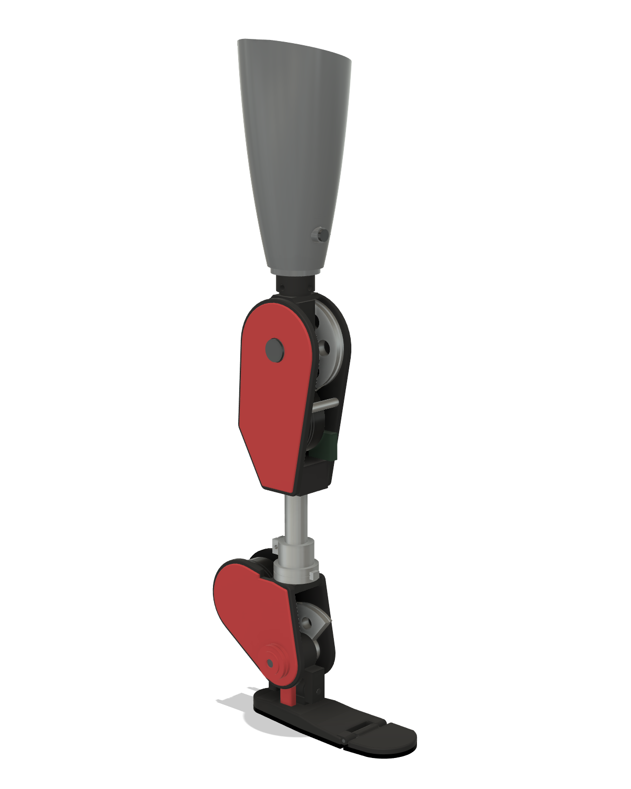
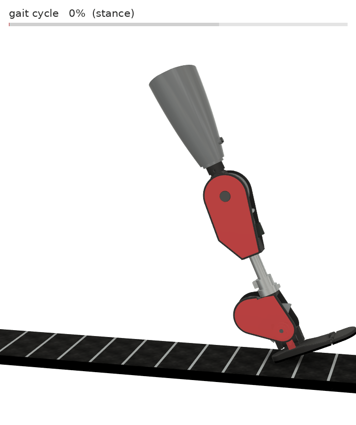
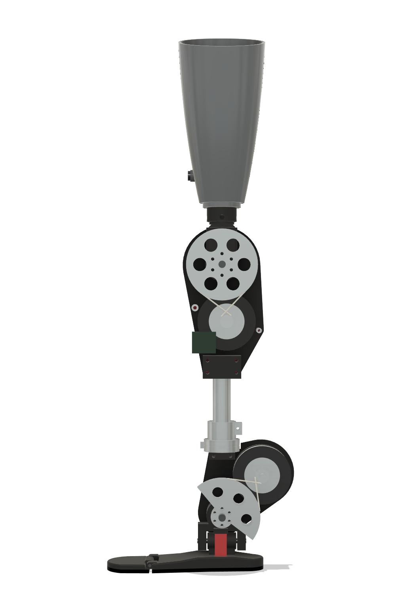
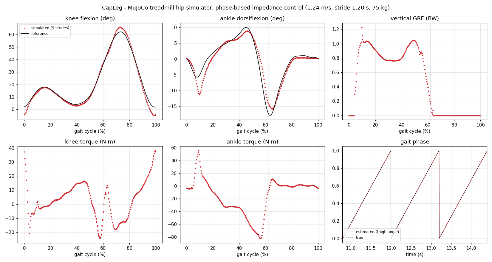
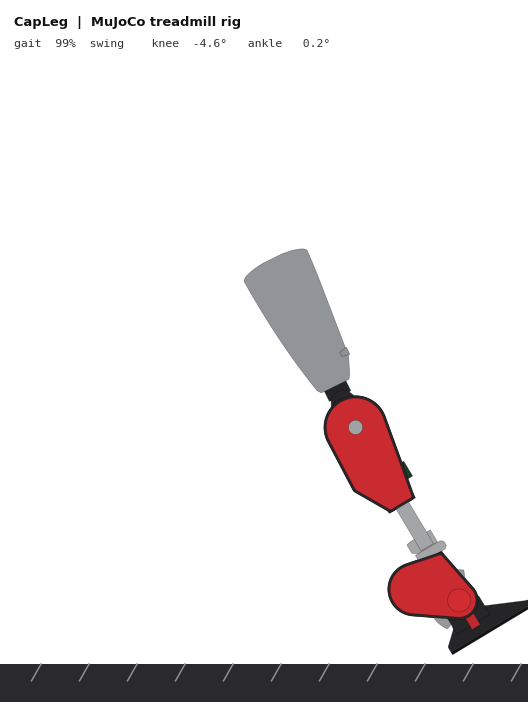

<div align="center">

# CapLeg

**An open, 3D-printable, capstan-driven powered knee–ankle prosthesis: from parametric CAD to closed-loop
simulation in MuJoCo, ROS 2 and Gazebo.**

[](https://github.com/Basar-mte/CapLeg/actions/workflows/ci.yml)
[](LICENSE)


| | |
|---|---|
|  |  |

</div>

CapLeg is a research platform for powered transfemoral prostheses. A single parametric **Fusion 360** model
generates everything else:

- 26 print-ready parts;
- a **ROS 2 Jazzy / Gazebo Harmonic** description with `ros2_control`;
- a **MuJoCo** model of the leg walking on a treadmill hip simulator.

One simulator-independent Python controller drives the leg in every simulator. It combines thigh-angle phase
estimation with phase-based impedance control.

> ⚠️ **Research prototype, not a medical device.** Read the [safety section](docs/BUILD_GUIDE.md#0-safety-first)
> before building anything.

## Contents

- [Highlights](#highlights)
- [Results](#results)
- [Quick start](#quick-start)
- [Documentation](#documentation)
- [Specifications](#specifications)
- [Repository layout](#repository-layout)
- [Roadmap](#roadmap)
- [Citation, license and contact](#citation)

## Highlights

- **Quasi-direct-drive capstan transmissions.** Each joint has an off-the-shelf CubeMars AK80-9 (9:1) followed by
  a single Dyneema capstan stage: 4.80:1 at the knee (43:1 total) and 5.20:1 at the ankle (47:1 total). That gives
  zero backlash, quiet operation, back-drivability and no printed gears.
- **Biomimetic passive elements:**
  - a two-axis ankle: powered pitch, plus passive inversion/eversion on TPU springs for uneven ground;
  - a **unilateral parallel-elastic ankle spring** that adds up to 65 N·m in dorsiflexion and is free in
    plantarflexion;
  - a spring-loaded **MTP toe joint**.
- **Research instrumentation.** An in-line 6-axis load cell, three IMUs (thigh, shank, foot) and actuator encoders.
- **Modular.** One switch selects the transfemoral leg or the transtibial ankle module. Standard male pyramid and
  Ø30 mm pylon interfaces are used, and the pylon length sets the build height.
- **One source of truth.** `tools/build_sim_models.py` turns the Fusion export into the URDF/xacro, MJCF, merged
  meshes, inertias and print STLs. CI checks that every generated file can be reproduced byte-for-byte.
- **Shared control core.** The same phase estimator, impedance law and actuator model run in MuJoCo and in ROS 2.
  Every gain is a live ROS parameter.



## Results

MuJoCo treadmill hip simulator, 75 kg user, 1.24 m/s belt, 1.2 s stride, 9 evaluated strides. The gait phase comes
from the thigh angle alone.



| Metric | Value |
|---|---|
| Knee tracking RMS (stance / swing) | 1.3° / 3.3° |
| Ankle tracking RMS (stance / swing) | 2.3° / 1.0° |
| Gait-phase estimate from thigh angle (mean / max error) | 0.15 % / 0.84 % of the cycle |
| Peak vertical GRF | 1.23 BW, normal double-hump profile |
| Knee peak / RMS torque | 38 / 13 N·m; net work −17 J per stride (absorbing, as in able-bodied gait) |
| Ankle peak / RMS motor torque | 83 / 32 N·m; peak power 250 W; net work +17 J per stride (push-off) |
| Toe peak dorsiflexion | 37° |
| Minimum mid-swing foot clearance | 26 mm |

<p align="center"></p>

You can reproduce these numbers with `python mujoco/run_rig.py`. The full numbers are in
[`mujoco/results/metrics.json`](mujoco/results/metrics.json). The ROS node logic was also checked software-in-the-loop
against the MuJoCo plant: 2.3° knee and 1.5° ankle RMS error, with a 1.200 s estimated stride time.

## Quick start

**MuJoCo** runs on Windows, macOS and Linux, needs no ROS, and takes about 5 minutes to set up.

```bash
git clone https://github.com/Basar-mte/CapLeg.git && cd CapLeg
python -m venv .venv && source .venv/bin/activate      # Windows: .venv\Scripts\activate
pip install -r requirements.txt
python mujoco/run_rig.py            # 12 strides -> mujoco/results/ (metrics, plots, log)
python mujoco/run_rig.py --view     # interactive viewer
```

**ROS 2 Jazzy + Gazebo Harmonic** needs Ubuntu 24.04, natively or in WSL2.

```bash
cd ros2_ws && colcon build --symlink-install && source install/setup.bash
ros2 launch capleg_description display.launch.py      # RViz + joint sliders
ros2 launch capleg_gazebo sim.launch.py               # physics: treadmill rig + impedance control
ros2 param set /capleg_controller knee.k_stance 500.0 # live gain tuning
```

**Tests:**

```bash
pip install -r requirements-dev.txt && pytest
```

The tests cover the core unit tests, the consistency of the xacro, URDF and MJCF models, and a closed-loop walking
run.

## Documentation

| Guide | What it covers |
|---|---|
| [Software setup](docs/SOFTWARE_SETUP.md) | MuJoCo, ROS 2/Gazebo (including WSL2), topics, parameters, troubleshooting |
| [Hardware build guide](docs/BUILD_GUIDE.md) | Safety, sourcing, printing, part preparation, module assembly, cable rigging, electronics, bench tests |
| [CAD workflow](docs/CAD_WORKFLOW.md) | Rebuilding the Fusion model, parameters, export, and regenerating every model |
| [Architecture](docs/ARCHITECTURE.md) | Mechanics, frames and sign conventions, control stack, simulator differences |
| [Bill of materials](docs/BOM.csv) · [Print report](cad/stl_print/print_report.csv) | Purchased parts · per-part material, size and mass |
| [Contributing](CONTRIBUTING.md) · [Changelog](CHANGELOG.md) | Development workflow · release history |

## Specifications

Default build, for a user about 1.75 m tall.

| | |
|---|---|
| Build height | knee axis → floor 510 mm; knee axis → pyramid top 83 mm; knee → ankle 420 mm (≥ 355 mm with the pylon fully shortened) |
| Mass | 3.96 kg without socket; 4.49 kg with printed check socket (aluminium capstans, PA-CF structure) |
| Knee | −5° … 120°; peak 102 N·m, rated 42 N·m, 12.4 rad/s no-load; reflected inertia 0.108 kg·m² |
| Ankle pitch | 20° plantar … 15° dorsi; peak 111 N·m (+65 N·m PEA), rated 45 N·m, 11.5 rad/s; 0.127 kg·m² |
| Ankle roll (passive) | ±10°, 120 N·m/rad TPU springs |
| Toe (passive) | 0 … 40° dorsiflexion, 45 N·m/rad |
| Electrical | 48 V bus, CAN (AK-series MIT mode), 1 kHz-capable impedance loop |
| Interfaces | male pyramid (knee head), Ø30 mm pylon clamps, 6-axis load cell above the ankle |

The actuator figures use the CubeMars AK80-9 V3.0 datasheet: 22 N·m peak, 9 N·m rated, 570 rpm no-load at 48 V,
rotor inertia 579 g·cm². A capstan efficiency of 0.97 is assumed.

## Repository layout

```text
CapLeg/
├── cad/
│   ├── fusion/CapLeg_Builder/      Fusion 360 script: builds the jointed assembly (parametric dict P)
│   ├── fusion/CapLeg_Export/       Fusion 360 script: exports STL/STEP/F3D + metadata
│   ├── CapLeg.f3d                  Fusion archive
│   ├── step/CapLeg_assembly.step   neutral CAD for any tool
│   ├── stl_print/                  26 print-oriented parts (mm) + print_report.csv
│   ├── stl_world/                  every body in the assembly frame (generator input)
│   └── fusion_export_meta.json
├── ros2_ws/src/
│   ├── capleg_description/         xacro/URDF, meshes, ros2_control + Gazebo xacro, RViz, display.launch.py
│   ├── capleg_gazebo/              treadmill world, controller YAMLs, sim.launch.py
│   └── capleg_control/             controller_node, gait_player, core/ (shared with MuJoCo), unit tests
├── mujoco/
│   ├── capleg_rig.xml + assets/    MuJoCo model on the treadmill hip simulator
│   ├── run_rig.py                  closed-loop simulation -> metrics, plots, log
│   ├── render_side_view.py         side-view GIF without OpenGL
│   └── results/                    reference run
├── tools/build_sim_models.py       Fusion export -> URDF/xacro, MJCF, meshes, inertias, print STLs
├── tests/                          model-consistency and closed-loop integration tests
├── docs/                           guides, BOM, images
└── .github/workflows/ci.yml        lint, tests, reproducibility check, ROS 2 build
```

## Roadmap

- [ ] Vendor bolt patterns for the AK80-9 stator and the load cell in the CAD
- [ ] Adjustable capstan cable tensioner
- [ ] Embedded firmware: a C++ port of the phase estimator and impedance controller (Teensy 4.1 / STM32, CAN MIT
      mode)
- [ ] Hardware-in-the-loop bench with real actuators
- [ ] Gait references for stairs, ramps and variable speed
- [ ] Structural FEA of the printed and machined load path, with ISO 10328 test planning

## References

- Azocar A. F. et al., "Design and clinical implementation of an open-source bionic leg", *Nature Biomedical
  Engineering* 4, 941–953 (2020).
- Winter D. A., *Biomechanics and Motor Control of Human Movement*, 4th ed., Wiley (2009).
- Quintero D., Villarreal D. J., Lambert D. J., Kapp S., Gregg R. D., "Continuous-phase control of a powered
  knee–ankle prosthesis: amputee experiments across speeds and inclines", *IEEE T-RO* 34(3) (2018).
- CubeMars AK80-9 V3.0 KV100 product data; ros2_control / gz_ros2_control (Jazzy) documentation.

## Citation

If CapLeg helps your research, please cite it. GitHub shows a *Cite this repository* button generated from
[CITATION.cff](CITATION.cff).

```bibtex
@software{roky_capleg_2026,
  author  = {Roky, Md. Abul Basar},
  title   = {CapLeg: a capstan-driven powered knee-ankle prosthesis research platform},
  year    = {2026},
  version = {1.0.0},
  url     = {https://github.com/Basar-mte/CapLeg}
}
```

## License

Released under the [Apache License 2.0](LICENSE). This covers the code, the CAD and the documentation.

## Contact

**Md. Abul Basar Roky**: [GitHub @Basar-mte](https://github.com/Basar-mte) · <m.a.basar.mte@gmail.com>

Issues and pull requests are welcome. See [CONTRIBUTING.md](CONTRIBUTING.md).
