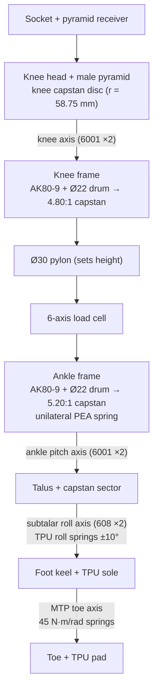
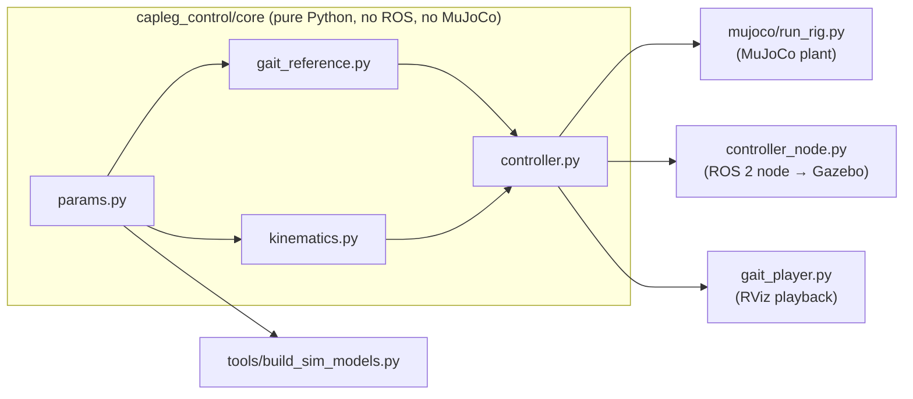

# Architecture

This document explains how CapLeg is put together: its mechanics, its frames and conventions, the control stack, and
how the same controller runs in MuJoCo and in ROS 2.

## 1. Mechanical concept



**Why capstans?** A capstan stage is a cable wrapped around a small drum and anchored on a large disc or sector. It
gives:

- zero backlash;
- high back-drivability;
- about 97 % efficiency;
- silent running;
- no printed gear teeth.

Paired with a 9:1 quasi-direct-drive actuator, it gives 43:1 at the knee and 47:1 at the ankle. That is enough
torque for level walking while staying transparent enough for impedance control.

| Joint | Drive | Peak / rated torque | No-load speed | Reflected inertia |
|---|---|---|---|---|
| Knee | AK80-9 × 4.80 capstan | 102 / 42 N·m | 12.4 rad/s | 0.108 kg·m² |
| Ankle pitch | AK80-9 × 5.20 capstan, + PEA up to 65 N·m | 111 / 45 N·m | 11.5 rad/s | 0.127 kg·m² |
| Ankle roll | passive TPU springs, 120 N·m/rad | — | — | — |
| Toe (MTP) | passive torsion springs, 45 N·m/rad | — | — | — |

All of these numbers are computed from the datasheet values in `params.py` by `joint_drive()`. Nothing is
hand-copied.

## 2. Frames and sign conventions

- **Units:** SI everywhere in code. The CAD is in mm.
- **Axes:** +X anterior, +Y medial (right leg), +Z up. Link frames align with the world at the zero pose (standing
  straight).
- **Link origins:**

  | Link | Origin |
  |---|---|
  | `capleg_thigh` | hip centre |
  | `capleg_shank` | knee axis |
  | `capleg_ankle_module` | load-cell centre |
  | `capleg_talus` | ankle pitch axis |
  | `capleg_foot` | subtalar axis |
  | `capleg_toe` | MTP axis |

- **Joint signs (URDF, MJCF, controller):**

  | Joint | + direction |
  |---|---|
  | knee | flexion |
  | ankle_pitch | dorsiflexion |
  | ankle_roll | inversion |
  | toe | dorsiflexion |
  | rig `hip` | thigh flexion |

  Fusion differs for the ankle and toe, see [CAD_WORKFLOW.md](CAD_WORKFLOW.md#1-open-or-rebuild-the-design).

- **Gait phase:** φ ∈ [0, 1), with 0 = heel strike and toe-off at φ = 0.62.

## 3. Software layout



| Module | Responsibility |
|---|---|
| `params.py` | Geometry, actuator datasheet values, capstan radii, joint limits, passive stiffnesses, rig and impedance defaults |
| `gait_reference.py` | Normative knee, ankle, thigh and toe trajectories as Fourier series; GRF and joint-moment tables |
| `kinematics.py` | Sagittal forward kinematics, rolling-foot stance track, treadmill speed, hip-height reference, swing clearance |
| `controller.py` | `PhaseEstimator`, `ImpedanceController`, `saturate` (actuator limits), `passive_torques`, `RigController` |

The core is deliberately dependency-free, so the same code can run in MuJoCo, in ROS 2, and later on a companion
computer.

## 4. Control

### Gait reference

The knee and ankle references are smooth periodic fits shaped after Winter's normative data. The thigh trajectory
is re-solved by inverse kinematics during stance, so that the hip progresses at a uniform belt speed over the
rolling, non-slipping CapLeg foot. A constant-speed treadmill rig driven with the raw normative thigh angle forces
the knee into a crouch, and this correction removes that.

### Phase estimation (thigh angle)

At each sample, the measured pair (thigh angle, thigh velocity) is matched to the nearest point on the reference
thigh phase portrait. The search runs only inside a forward window around the predicted phase φ + dt/T, and a weak
prior on that prediction regularises it. A parabolic refinement then gives sub-sample resolution. The resulting
estimate:

- is continuous and essentially monotonic;
- re-estimates the stride time T at every heel strike, using an exponential filter;
- needs only a thigh IMU or a hip encoder;
- takes about 30 µs per update.

### Impedance law

```
τ = K(φ)·(q_ref(φ) − q) + B(φ)·(q̇_ref(φ) − q̇) + τ_ff(φ)
```

- **K and B** blend smoothly between stance and swing values, using a smoothstep around toe-off and heel strike.
- **τ_ff** is a scaled normative moment: 0.55 × the ankle plantarflexor moment and 0.15 × the knee moment in
  stance. In swing it adds reflected-inertia compensation, J_reflected · q̈_ref.
- **Saturation** applies the actuator model: peak torque, plus a linear torque–speed limit in the motoring quadrant.

Every gain is a ROS parameter that you can change live.

### Hip simulator (treadmill rig)

Both simulators mount the leg on a three-axis rig:

- `rig_x`: belt progression;
- `rig_z`: vertical carriage;
- `hip`: thigh angle.

`RigController` prescribes the thigh angle and the belt progression. In stance, it presses the hip down with a
body-weight-scaled normative GRF profile, applied only after foot contact and ramped in over 30 ms. In swing, it
servos the hip height that a contralateral leg would provide. So the prosthesis carries body weight, but the
controller sees only what a real device sees: the thigh angle and its own joints.

## 5. Simulator differences

| | MuJoCo | Gazebo Harmonic (DART) |
|---|---|---|
| Rotor inertia | modelled (`armature` = reflected inertia) | not modelled |
| Passive roll, toe and PEA springs | native (joint stiffness, tendon spring) | emulated in software by the controller node (`software_passive`) |
| Contact | soft contact, tuned `solref`/`solimp`, elliptic cones | default DART contact |
| Rig axes | force- and torque-driven (`fx`, `tau_hip`) | position controllers via `ros2_control` |
| Use it for | controller development, metrics, regression tests | ROS integration, `ros2_control` pipeline, visualisation |

The ROS node logic was also checked software-in-the-loop against the MuJoCo plant. Tracking RMS was 2.3° at the knee
and 1.5° at the ankle, and the estimated stride time was 1.200 s.
