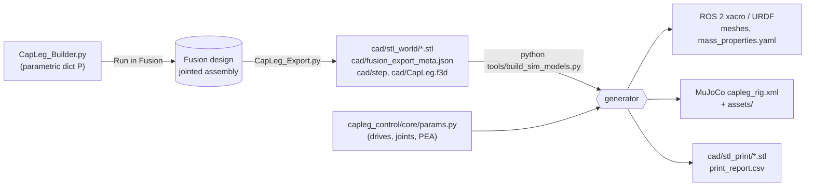

# CAD workflow: from Fusion 360 to every simulator

The Fusion 360 model is the single source of truth. One script builds it and one exports it. A Python generator then
turns the export into every downstream file, so geometry, masses and inertias never drift apart.



## 1. Open or rebuild the design

**Option A: import the archive.** In Fusion, choose *File → Open → Open from my computer* and pick
[`cad/CapLeg.f3d`](../cad/CapLeg.f3d).

**Option B: rebuild from the script.** This is the reproducible route.

1. Open *UTILITIES → ADD-INS → Scripts and Add-Ins*.
2. Click *Scripts → (+)* and select the folder `cad/fusion/CapLeg_Builder`.
3. Select **CapLeg_Builder** and click *Run*. A new design opens and builds in about 20 s.

Drive the joints with *ASSEMBLE → Drive Joints*: `knee`, `ankle_pitch`, `ankle_roll` and `toe`. Joint limits are set.

> **Sign conventions differ between Fusion and the robot description.** In Fusion, knee + is flexion,
> ankle_pitch + is **plantar**flexion, roll + is inversion and toe **−** is dorsiflexion. The URDF and MJCF use
> **+ dorsiflexion** for the ankle and toe. The generator handles the conversion.

## 2. Change parameters

The top of `CapLeg_Builder.py` holds a parameter dictionary `P`, in millimetres. The most useful entries:

| Parameter | Default | Effect |
|---|---|---|
| `shank_len` | 420 | Knee axis → ankle pitch axis. The pylon follows. This sets the user height |
| `ankle_h` | 90 | Ankle pitch axis → floor |
| `knee_disc_r` / `ankle_sector_r` | 57.5 / 62.5 | Capstan radii, which set the reduction ratio together with `drum_r` |
| `drum_r` | 11.0 | Capstan drum radius (Ø22) |
| `knee_motor`, `ankle_motor_ang`, `ankle_motor_d` | — | Actuator placement |
| `plate_in`, `plate_t`, `cover_t` | 27 / 8 / 3 | Frame width and wall thicknesses |

If you change a dimension that the control code also uses (`shank_len`, `thigh_len`, `roll_dz`, toe position, capstan
radii), also update [`capleg_control/core/params.py`](../ros2_ws/src/capleg_control/capleg_control/core/params.py).
That file is read by the generator, MuJoCo and ROS 2.

## 3. Export

Add and run `cad/fusion/CapLeg_Export` the same way as the builder. It writes, relative to the repository root:

- `cad/stl_world/*.stl`: every body at the zero pose, in the assembly frame, in mm;
- `cad/fusion_export_meta.json`: the mapping from body to component, the appearances and the joint data;
- `cad/step/CapLeg_assembly.step` and `cad/CapLeg.f3d`.

**Naming rules.** The generator depends on these names:

- **Components** must stay `CapLeg_Thigh`, `CapLeg_Shank`, `CapLeg_Talus`, `CapLeg_Foot` and `CapLeg_Toe`. These
  map to URDF links.
- **Body names** start with a code: `Pnn_` for printed parts, `Hnn_` for purchased hardware. The code selects the
  link group, the material density (and so the mass) and the print orientation. See `KNEE_MODULE`, `ANKLE_MODULE`,
  `PRINT_ORIENT` and `PRINT_MATERIAL` in `tools/build_sim_models.py`.
- **When you add a body,** give it a new code and, where needed, add the code to those tables.

## 4. Regenerate

```bash
pip install -r requirements.txt
python tools/build_sim_models.py
```

This takes a few seconds and rewrites:

| Output | Used by |
|---|---|
| `ros2_ws/src/capleg_description/meshes/visual/*.stl` | Visual meshes, merged per link and colour, link frame, metres |
| `ros2_ws/src/capleg_description/urdf/*.xacro` | ROS 2 (RViz, Gazebo, ros2_control) |
| `ros2_ws/src/capleg_description/urdf/generated/*.urdf` | Standalone URDFs for PyBullet, Isaac Sim, Webots and MuJoCo |
| `ros2_ws/src/capleg_description/config/mass_properties.yaml` | Mass, CoM and inertia per link, plus a per-body mass table |
| `mujoco/capleg_rig.xml`, `mujoco/assets/` | MuJoCo treadmill rig |
| `cad/stl_print/*.stl`, `print_report.csv` | Print-oriented parts, sizes, volumes, masses and bed-fit checks |

The generator is deterministic. CI rebuilds the models from the committed export and fails if any generated file
differs. Always commit the export and the regenerated files together.

## 5. Verify

```bash
pytest                         # model consistency (xacro variants, joint names, meshes) + closed-loop run
python mujoco/run_rig.py       # compare metrics.json with the previous run
```
